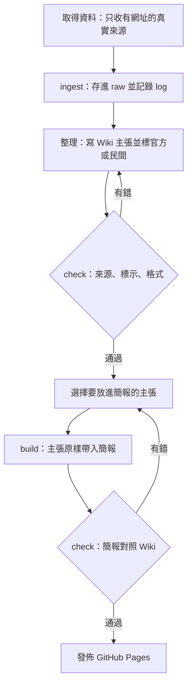

# 韓國自由行 LLM Wiki 與教學簡報

主題：台灣旅客的韓國自由行須知。用「來源可追溯的 LLM Wiki」產生教學簡報，簡報的每個事實都能追回 Wiki 主張，再追回原始來源。

- 簡報：打開 `index.html`（GitHub Pages）
- Wiki：`wiki/`（索引、5 個主題頁、操作紀錄）
- 原始來源：`raw/`（13 份，S01 到 S13，查證日 2026-10-31，沿用第七週整理並重新查證）
- 規則文件：`AGENTS.md`；工具：`tools/wiki.py`；檢查紀錄：`check-log.txt`

## 作業要求對照

| 作業要求 | 成果位置 |
|---|---|
| 先討論、後生成 | 下方「討論紀錄」；對話截圖附在繳交內容 |
| 至少 ingest 5 篇資料 | `raw/` 共 13 份，`wiki/log.md` 有 ingest 紀錄 |
| 建立 LLM Wiki | `wiki/`：5 個主題頁，23 條主張，每條標【官方】或【民間】並附 [Sxx] |
| 用 Wiki 製作教學簡報 | `index.html` 共 8 頁：封面、五個單元、自我檢查、重點回顧；每頁標示 Wiki 頁面，每張卡片附來源連結 |
| loop / graph 設計 | 下方流程圖與說明 |
| 一次實際執行的檢查紀錄 | 下方「實際執行」與 `check-log.txt` |
| 反思 | 下方「反思」 |

## 討論紀錄（先討論）
1. 第一版草稿的資料沒有網址，內容也和官方頁面不一致，無法追溯。
2. 討論後決定：只收有網址的來源，改用第七週已整理並對照官方頁面的 13 份。
3. 決定主張格式：`- {id} 【官方|民間】內容 [Sxx]`，讓每個事實都能被檢查。
4. 決定簡報只能引用 Wiki 主張，文字由程式原樣帶入，不由 AI 重寫。

## 流程（loop / graph）

- **會重複的步驟**：兩個 check 到「通過」為止；有錯就退回上一步，不往下走。
- **檢查的內容**：每條主張有來源且來源存在；標【官方】的主張至少引用一份官方網址（boca.gov.tw、visitkorea.or.kr）；每份 raw 都被引用；簡報引用的主張存在且文字與 Wiki 一致；簡報說明文字不得出現數字。
- **為什麼這樣設計**：錯誤越早發現越便宜。若只在簡報完成後才看，錯誤已經擴散到 Wiki 和簡報。簡報文字由程式帶入而不是 AI 重寫，是為了避免 AI 在最後一步加入 Wiki 沒有的內容。

## 實際執行
```
python3 tools/wiki.py build   → 已產生 index.html（8 頁）
python3 tools/wiki.py check   → 來源 13 份，主張 23 條，簡報 8 頁，錯誤 0 項（通過）
```
`check-log.txt` 另有三組**檢查器自我測試**（在暫存副本故意放錯，確認檢查會擋下）：民間來源被標成官方、簡報金額與 Wiki 不一致、主張沒附來源。這三組是測試檢查器本身，不是流程中真實發生的錯誤。

## 反思
- **最常出錯的節點：取得資料。** 第一版草稿的資料沒有網址，內容也與官方有出入（K-ETA 免申請期限、入境卡、Q-Code），無法追溯。
- **把檢查前移到哪裡：** 從「簡報完成後才看」前移到 ingest 之前與寫主張時：只收有網址的真實來源、官方與民間分開標示，並把「標官方必須有官方網址」寫成 `tools/wiki.py` 的檢查，錯誤在寫 Wiki 時就會被擋下。
- **有修改 workflow：** 是。原本只有「取得資料 → 生成簡報」；改成加入 raw 層、主張格式與兩個 check，並讓簡報只能引用 Wiki 主張。原因是錯誤出在最前面的資料，卻到最後才被發現。
