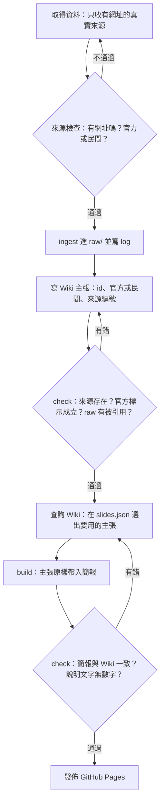

# Loop / Graph 設計

## 哪些步驟會重複
有三個迴圈：B 退回 A（來源不合格就換來源）、E 退回 D（主張有錯就改 Wiki）、H 退回 F（簡報有錯就改大綱）。每個迴圈都是跑到通過為止。

## 哪裡檢查或重新生成
- B：來源檢查，目前由人判斷來源是否真實、屬於官方或民間。
- E：`python3 tools/wiki.py check` 檢查 Wiki 與 raw 的對應。
- H：`build` 之後再跑一次 `check`，確認簡報沒有超出 Wiki。
- 重新生成：Wiki 有修改，簡報一定要重新 build，不手改 index.html。

## 為什麼這樣設計
錯誤越晚發現，修正成本越高。簡報看起來完整，但事實可能早就錯了。所以把檢查放在資料進來之前（B）、Wiki 寫完之後（E）、簡報產生之後（H）三個位置，每一關只負責一種錯誤。
